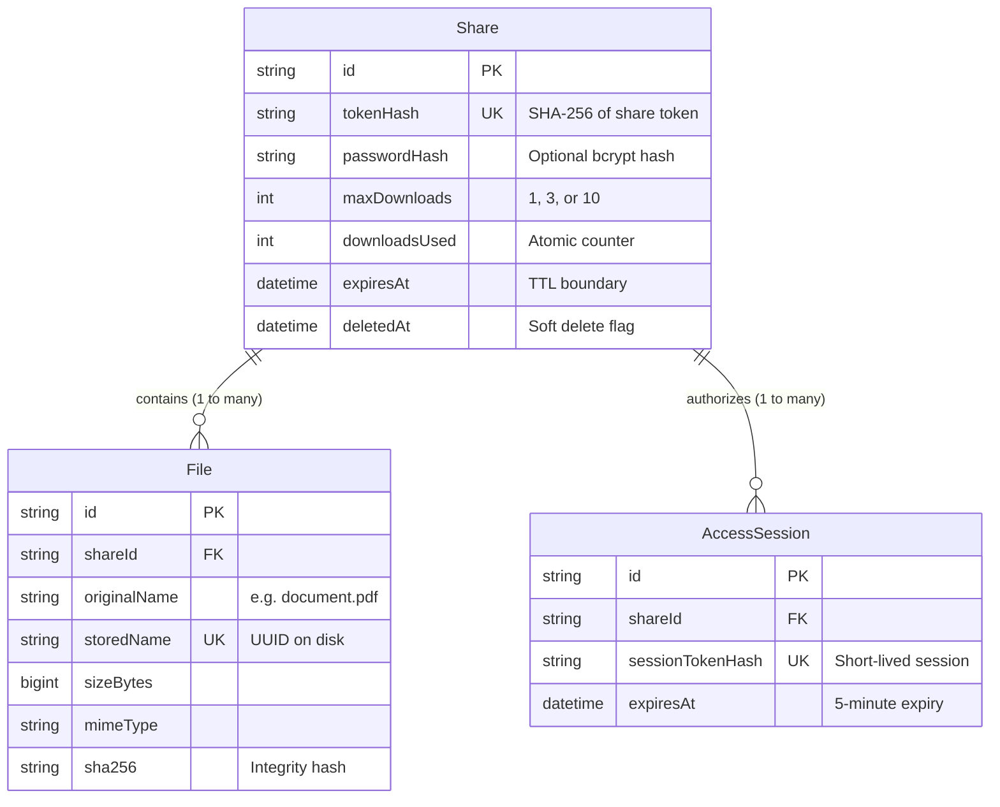

# 🎓 Theoretical Foundations of FileNotFound
### A Beginner's Guide to Zero-Trust Ephemeral File Transfer, Cryptography & High-Concurrency Backend Architecture

---

## 📖 Table of Contents
1. [Introduction: The Big Picture](#1-introduction-the-big-picture)
   - What is FileNotFound?
   - The Real-World Analogy: The "Mission Impossible" Note
   - Why Traditional Cloud Drives Fail the Privacy Test
2. [Core Cryptography & Security (Zero-Trust Fundamentals)](#2-core-cryptography--security-zero-trust-fundamentals)
   - Cryptographic Entropy & Secure Random Numbers (`crypto.randomBytes`)
   - The Golden Trio: Encoding vs. Encryption vs. Hashing
   - Why We NEVER Store Raw Tokens in the Database
   - Password Security & Adaptive Slow Hashing (`bcrypt`)
   - Side-Channel Timing Attacks (`timingSafeEqual`)
3. [Concurrency, Race Conditions & Database Engineering](#3-concurrency-race-conditions--database-engineering)
   - What is a Race Condition? (The ATM Analogy)
   - The TOCTOU Trap (Time of Check vs. Time of Use)
   - Atomic Conditional Updates in PostgreSQL
   - Relational Data Modeling & Cascading Deletes
4. [Storage, File System & Networking Mechanics](#4-storage-file-system--networking-mechanics)
   - Path Traversal Attacks & Why Filenames Lie
   - Memory Safety: Streaming vs. In-Memory Buffering
   - Two-Tier Expiry: Request-Time Gates vs. Background Cleaners (`cron`)
   - Zero-Knowledge Metadata Exposure
5. [API Protection & Defense in Depth](#5-api-protection--defense-in-depth)
   - Rate Limiting (Preventing Brute-Force & DoS)
   - Security Headers (`Helmet`) & Network Boundaries
   - Input Validation with Zod (Fail-Fast Principle)
   - Zero-Leakage Structured Logging
6. [Visual End-to-End Workflow](#6-visual-end-to-end-workflow)
7. [Beginner's Glossary of Must-Know Terms](#7-beginners-glossary-of-must-know-terms)

---

## 1. Introduction: The Big Picture

### What is FileNotFound?
**FileNotFound** is an **ephemeral (short-lived), zero-trust file transfer service**. 

In plain English: It allows someone to send private, sensitive files (like financial records, API keys, legal contracts, or confidential photos) to someone else with the guarantee that:
1. The link works **only for a limited time** (e.g., 10 minutes, 1 hour, or 24 hours).
2. The link works **only for a limited number of downloads** (e.g., exactly 1, 3, or 10 times).
3. Optionally, the recipient must provide a **secret password** before they can see or download anything.
4. Once the time runs out or the download quota is hit, the file **destroys itself permanently from the disk and database**.

---

### The Real-World Analogy: The "Mission Impossible" Note
Think of ordinary cloud storage (like Google Drive, Dropbox, or OneDrive) like a **public storage locker**:
- You put your documents inside.
- You give someone a key copy.
- The locker company has a master key.
- The papers sit in the locker forever until you remember to go back and throw them away. If someone steals the key 5 years later, your papers are still there.

**FileNotFound** is like the self-destructing tape recorder in *Mission Impossible*:
> *"This message will self-destruct in 10 minutes or immediately after you listen to it."*

Once the recipient listens to it (downloads it) or the timer runs out, it burns into ash. Even if a hacker breaks into the room 10 seconds later, **there is nothing left to steal**.

---

### Why Traditional Cloud Drives Fail the Privacy Test
| Feature | Traditional Cloud (Drive / Dropbox) | FileNotFound (Zero-Trust Ephemeral) |
| :--- | :--- | :--- |
| **Persistence** | Permanent by default | Ephemeral (self-destructing) |
| **Link Lifetime** | Active indefinitely until manually revoked | Strict TTL (Time-To-Live: 10m / 1h / 24h) |
| **Download Cap** | Unlimited downloads by anyone with the link | Hard atomic limit (e.g., 1-time download) |
| **Database Breach Risk**| If the database leaks, all file links are exposed | If the DB leaks, **raw links cannot be recovered** |
| **Metadata Privacy** | Anyone with the link sees filename & preview | Password-protected files reveal **zero metadata** |
| **Disk Cleanup** | "Deleted" items linger in trash cans / backups | Physical file deletion on disk (`unlink`) |

---

## 2. Core Cryptography & Security (Zero-Trust Fundamentals)

### 2.1 Cryptographic Entropy & Secure Random Numbers

When you generate a link like `https://app.com/s/7xK9pQ...`, how do we make sure a hacker cannot guess the link of another user?

#### Why `Math.random()` is Dangerous
Every beginner learns `Math.random()` in JavaScript. **Never use `Math.random()` for security.**
`Math.random()` is a **Pseudo-Random Number Generator (PRNG)**. It uses a predictable mathematical formula. If an attacker observes a few generated values, they can mathematically predict all future and past links!

#### CSPRNG (`crypto.randomBytes`)
FileNotFound uses Node.js's built-in **Cryptographically Secure Pseudo-Random Number Generator (CSPRNG)**:
```typescript
import crypto from 'node:crypto';

// Generates 32 cryptographically random bytes (256 bits of entropy)
const rawToken = crypto.randomBytes(32).toString('base64url');
```

#### What is "256 Bits of Entropy"?
- 32 bytes = 256 bits ($2^{256}$ possible combinations).
- $2^{256}$ is roughly $1.15 \times 10^{77}$.
- For perspective, the estimated number of atoms in the entire observable universe is around $10^{80}$.
- It would take all the supercomputers on Earth billions of years of brute-force guessing to guess a single valid link.

#### Why `base64url`?
Standard Base64 encoding uses characters like `+`, `/`, and `=`. In web URLs, these characters have special meanings (`+` turns into space, `/` is a directory path, `=` is a query parameter). 
`base64url` replaces `+` with `-`, `/` with `_`, and strips `=` padding, making the token 100% safe to put directly into a browser URL.

---

### 2.2 The Golden Trio: Encoding vs. Encryption vs. Hashing

Beginners often use these three terms interchangeably, but they are fundamentally completely different tools:

```
[ Data ]  ────────────── (Reversible without key) ─────────────► [ Encoded Data ] (e.g., Base64)
[ Data ]  +  [ Secret Key ] ── (Reversible with key) ──────────► [ Encrypted Ciphertext ] (e.g., AES)
[ Data ]  ────────────── (ONE-WAY ONLY, Irreversible) ────────► [ Cryptographic Hash ] (e.g., SHA-256)
```

1. **Encoding (e.g., Base64, URL encoding)**:
   - **Purpose**: Translates binary data into readable text so computers can transmit it safely.
   - **Security**: **Zero security.** Anyone can decode it immediately without any password or key.
2. **Encryption (e.g., AES-256, RSA)**:
   - **Purpose**: Conceals data so only someone with the secret key can decrypt and read it.
   - **Security**: Two-way. Scrambled with a key, readable again with the key.
3. **Hashing (e.g., SHA-256, SHA-3)**:
   - **Purpose**: Computes a unique, fixed-length digital fingerprint of data.
   - **Security**: **One-way only.** It is mathematically impossible to reverse a hash back to its original input.
   - Example: 
     - Input: `"Hello"` $\rightarrow$ SHA-256: `185f8db32271fe25f561a6fc938b2e264306ec304eda518007d1764826381969`
     - Input: `"Hello."` (added one dot) $\rightarrow$ SHA-256: `785f72...` (completely different output; known as the **Avalanche Effect**).

---

### 2.3 Why We NEVER Store Raw Tokens in the Database

This is one of the most important principles in Zero-Trust backend design.

#### The Problem
Suppose our server generates a link with token `secretToken123`. If we save `secretToken123` directly into the database:
- What if a rogue database administrator browses the database table?
- What if our daily database backup file is accidentally leaked or stolen?
- What if an SQL injection vulnerability allows an attacker to dump the `Share` table?

If raw tokens are in the database, the attacker can immediately copy all tokens, paste them into their browser, and download everyone's private files!

#### The Solution: The "Coat Check" / Deterministic Hashing Model
```
[ User Browser Link ]                [ FileNotFound Backend ]                  [ PostgreSQL Database ]
https://app.com/s/{rawToken}  ────►  Computes SHA-256(rawToken)  ────►  Matches WHERE tokenHash = {hash}
```

1. The server generates `rawToken` and gives it **only to the sender** in the URL.
2. The server computes `tokenHash = SHA256(rawToken)` and stores **only** the `tokenHash` in PostgreSQL.
3. The server immediately throws `rawToken` out of its memory.
4. When the receiver clicks the link, their browser sends `rawToken`. The server hashes it again with SHA-256 and searches PostgreSQL for the matching hash.

**The Security Guarantee:**
If our database is completely hacked and leaked online, the attacker gets a list of SHA-256 hashes. Because SHA-256 is mathematically irreversible, **the attacker cannot reconstruct even a single download URL!**

---

### 2.4 Password Security & Adaptive Slow Hashing (`bcrypt`)

Why do we use `SHA-256` for tokens, but `bcrypt` for user passwords?

#### Fast Hashes (SHA-256) vs. Slow Hashes (bcrypt)
- SHA-256 was designed by the NSA to be **extremely fast**. A modern computer with a graphics card (GPU) can calculate **billions** of SHA-256 hashes per second.
- If a user picks a simple password like `"football"`, and you hash it with SHA-256, an attacker can compare it against billions of dictionary words in less than 1 second (a **dictionary attack**).

#### How bcrypt Protects Passwords:
1. **Salting**: bcrypt generates a random string of characters (called a **salt**) and mixes it into the password before hashing. 
   - Even if two users choose the exact same password `"secret123"`, their bcrypt hashes will look completely different!
   - This completely defeats **Rainbow Tables** (pre-computed lists of millions of leaked hashes).
2. **Work Factor (Cost)**:
   - bcrypt is intentionally designed to be **slow and computationally heavy**.
   - With a work factor of 12 (used in FileNotFound), computing one single bcrypt check takes around 250 milliseconds of CPU time.
   - For a real user logging in, 250ms is unnoticeable.
   - But for a hacker trying to guess 10,000,000 passwords, 250ms per guess would take **nearly 80 years**!

---

### 2.5 Side-Channel Timing Attacks (`timingSafeEqual`)

Imagine trying to open a safe by turning a dial. If the safe makes a faint "click" sound whenever you hit a correct number, you can easily crack the combination one digit at a time by listening for the clicks!

In computer science, this is called a **Timing Attack**.

#### Standard String Comparison Leaks Information
In standard JavaScript:
```typescript
if (userProvidedToken === storedSecret) { ... }
```
JavaScript compares strings character-by-character from left to right. As soon as it finds the first mismatched character, it stops comparing immediately (**early return** for performance).

- If the first character is wrong: comparison takes **1 nanosecond**.
- If the first 10 characters are right, but the 11th is wrong: comparison takes **10 nanoseconds**.

A sophisticated attacker can send thousands of requests with different characters, measure response times with microsecond precision, and figure out the secret character by character!

#### The Fix: Constant-Time Comparison
```typescript
import crypto from 'node:crypto';

// Always inspects every single byte, taking the exact same time regardless of matches
crypto.timingSafeEqual(bufferA, bufferB);
```
In FileNotFound's `safeCompare.ts`, we use `crypto.timingSafeEqual` so that whether 0 characters or all characters match, the function takes the exact same amount of time. The "click" is silenced.

---

## 3. Concurrency, Race Conditions & Database Engineering

### 3.1 What is a Race Condition? (The ATM Analogy)

Imagine you have \$100 in your bank account. You and a friend go to two different ATMs at the exact same second.

**The Naive Flawed Workflow:**
1. ATM A asks the bank: *"Does user have \$100?"* $\rightarrow$ Bank says: *"Yes."*
2. ATM B asks the bank: *"Does user have \$100?"* $\rightarrow$ Bank says: *"Yes."*
3. ATM A dispenses \$100.
4. ATM B dispenses \$100.
5. Both ATMs update the balance to \$0.
**Result**: You withdrew \$200 from a \$100 balance because of the time delay between checking and updating!

In software engineering, this is known as **TOCTOU: Time-of-Check to Time-of-Use**.

---

### 3.2 The TOCTOU Trap in File Sharing
Suppose a user creates a 1-time self-destructing file (`maxDownloads = 1`).
An attacker writes a script that fires 10 simultaneous download requests at the exact same millisecond.

If the backend code looks like this:
```typescript
// ❌ WRONG: Vulnerable to Race Conditions!
const share = await prisma.share.findUnique({ where: { tokenHash } });

if (share.downloadsUsed < share.maxDownloads) {
  // Delay here while server prepares file...
  await prisma.share.update({
    where: { tokenHash },
    data: { downloadsUsed: share.downloadsUsed + 1 }
  });
  streamFileToUser();
}
```
All 10 requests read `downloadsUsed = 0` at the same time before any request has updated it! All 10 requests get the file. The 1-download limit was completely broken.

---

### 3.3 The Solution: Atomic Conditional Updates in PostgreSQL

Instead of checking in JavaScript and then saving in PostgreSQL, we let **PostgreSQL handle both at the exact same time inside an atomic database instruction**:

```sql
UPDATE "Share"
SET "downloadsUsed" = "downloadsUsed" + 1
WHERE "tokenHash" = $1
  AND "deletedAt" IS NULL
  AND "expiresAt" > timezone('UTC', NOW())
  AND "downloadsUsed" < "maxDownloads";
```

#### How this works under the hood:
1. PostgreSQL places a **row-level lock** on that share row for a fraction of a millisecond.
2. Even if 50 requests arrive simultaneously, PostgreSQL queues them up and executes them one by one.
3. The 1st request sees `downloadsUsed = 0 < 1`. The condition is TRUE. It increments `downloadsUsed` to `1`. Affected rows = `1` (Success!).
4. The 2nd request sees `downloadsUsed = 1 < 1`. The condition is FALSE! The query updates **0 rows**.
5. When our backend sees `updatedCount === 0`, it immediately rejects the request with `404 Not Found`.

#### "Reservation Before Bytes" Rule
FileNotFound **reserves and commits the download slot in the database before streaming even a single byte of file data to the user**. 
Even if the receiver unplugs their ethernet cable halfway through, the download token has been consumed and cannot be abused again.

---

### 3.4 Relational Data Modeling & Cascading Deletes

FileNotFound uses **PostgreSQL** managed through **Prisma ORM**.



#### What is `onDelete: Cascade`?
Notice that both `File` and `AccessSession` have foreign keys pointing back to `Share` with `onDelete: Cascade`.
In database theory:
- When a `Share` record is permanently deleted, PostgreSQL automatically deletes all related `File` records and `AccessSession` records in the exact same transaction.
- You never end up with **"orphan records"** (garbage data pointing to a parent that no longer exists).

---

## 4. Storage, File System & Networking Mechanics

### 4.1 Path Traversal Attacks & Why Filenames Lie

Never trust a filename sent by a user!

#### The Threat: Path Traversal (Directory Traversal)
If a user uploads a file with the name:
```text
../../../../../../Windows/System32/drivers/etc/hosts
```
or on Linux:
```text
../../../../../../etc/shadow
```
If your server code writes the file using `fs.writeFile("./uploads/" + file.name)`:
The `../` sequences walk backward out of the `uploads` folder and overwrite critical operating system files! This can destroy the server or give an attacker root access.

#### The FileNotFound Solution:
1. **UUID Renaming**: The moment a file hits the server, its physical file on disk is named with a random UUID:
   - User uploaded: `my_resume.pdf`
   - Saved on disk: `uploads/9b1deb4d-3b7d-4bad-9bdd-2b0d7b3dcb6d`
2. **Database Mapping**: The original human-friendly name (`my_resume.pdf`) is stored **only as text in PostgreSQL**.
3. **Private Directory**: The `uploads/` folder is located completely outside any public web folder. Nobody can browse to `http://app.com/uploads/...`. Files can ONLY be read when the backend explicitly streams them through an authorized handler.

---

### 4.2 Memory Safety: Streaming vs. In-Memory Buffering

What happens if 20 users simultaneously download a 100 MB video file?

#### The Naive Beginner Approach (Buffering):
```typescript
// ❌ WRONG: Reads the entire 100MB into Node.js RAM!
const fileBuffer = fs.readFileSync(filePath);
res.send(fileBuffer);
```
- 20 users $\times$ 100 MB = **2,000 MB (2 Gigabytes)** of server RAM used just to hold files in memory!
- On a small cloud server or container with 512 MB of RAM, the server will instantly crash with an `Out of Memory (OOM)` error.

#### The Professional Approach: Node.js Streams
```typescript
// ✅ CORRECT: Piped streaming chunk-by-chunk
const readStream = fs.createReadStream(filePath);
readStream.pipe(res);
```
A **Stream** works like a water pipe:
- The server reads a tiny chunk (e.g., 64 KB) from the hard drive and sends it directly over the network wire.
- It then reads the next 64 KB, sends it, and recycles the memory buffer.
- Whether the file is 1 Megabyte or 10 Gigabytes, the server uses **less than 1 Megabyte of RAM** per user!

#### Dynamic ZIP Streaming with `archiver`
When a user uploads 5 files in a single share, how does the receiver download all of them?
FileNotFound does not create a heavy `.zip` file on disk beforehand. Instead, it uses `archiver` to compress the files into a `.zip` stream **on-the-fly directly into the HTTP response socket**. Zero wasted disk space!

---

### 4.3 Two-Tier Expiry: Request-Time Gates vs. Background Cleaners

How does a file actually "expire"?

In beginner projects, developers often rely only on a background timer: *"Every 10 minutes, check for expired files and delete them."*
**The Flaw**: What if a file expires at 12:01, but the cleanup job doesn't run until 12:10? For 9 minutes, someone could still access an expired link!

FileNotFound solves this with a **Two-Tier Architecture**:

```
                              ┌────────────────────────────────────────┐
                              │ Incoming Request to /api/shares/:token │
                              └──────────────────┬─────────────────────┘
                                                 │
                                                 ▼
                              ┌────────────────────────────────────────┐
                              │ Tier 1: Synchronous Request-Time Gate   │
                              │ Is NOW() > expiresAt?                  │
                              │ Or downloadsUsed >= maxDownloads?      │
                              └──────────┬───────────────────┬─────────┘
                                         │ YES               │ NO
                                         ▼                   ▼
                              ┌────────────────────┐   ┌───────────────┐
                              │ Return 404 Generic │   │ Serve Content │
                              │ Immediately        │   └───────────────┘
                              └────────────────────┘

               ───────────────────────────────────────────────────────────

                              ┌────────────────────────────────────────┐
                              │ Tier 2: Background Cron Worker          │
                              │ Runs periodically every 5 minutes      │
                              └──────────────────┬─────────────────────┘
                                                 │
                                                 ▼
                              ┌────────────────────────────────────────┐
                              │ 1. Find all expired or exhausted shares│
                              │ 2. Unlink & shred files from disk      │
                              │ 3. Wipe password hashes & sessions     │
                              │ 4. Purge disk orphans                  │
                              └────────────────────────────────────────┘
```

1. **Tier 1 (Instant Gate)**: Every single HTTP request validates `expiresAt > NOW()` right in the SQL query. If a link expired 1 millisecond ago, it is blocked instantly, guaranteed.
2. **Tier 2 (Physical Shredder)**: The `node-cron` background job runs every 5 minutes to free up hard drive storage, unlinking physical files (`fs.unlink`) and cleaning up database tables.

---

### 4.4 Zero-Knowledge Metadata Exposure

If a link is password-protected, what should a user see before entering the password?

**The Leaky Approach**:
> *"Password required to download: confidential_payroll_report_ceo.xlsx (12.4 MB)"*

Even without the password, the attacker learned that the CEO's payroll report exists and how large it is!

**The Zero-Knowledge Approach in FileNotFound**:
Before the password is verified:
- `files`: Empty array `[]`
- `fileCount`: Hidden
- `totalSize`: Hidden
- `expiresAt`: Hidden
- Only one flag is returned: `{ requiresPassword: true }`.

An unauthorized visitor learns **absolutely nothing** about what is inside.

---

## 5. API Protection & Defense in Depth

### 5.1 Rate Limiting (Preventing Brute-Force & DoS)

If an attacker knows a link is protected by a 4-digit PIN or a simple password, what stops them from sending 1,000,000 guesses a second?

**Rate Limiting** monitors incoming requests per IP address:
- In FileNotFound, password verification endpoints are capped (e.g., maximum 5 password attempts per minute per IP).
- If someone exceeds this, Express immediately returns `429 Too Many Requests`.

---

### 5.2 Security Headers (`Helmet`)

When a browser visits a site, the server can send special HTTP headers instructing the browser how to defend itself:
- **X-Content-Type-Options: nosniff**: Prevents the browser from trying to guess ("sniff") the MIME type of a file, stopping malicious executable code disguised as images.
- **Strict-Transport-Security (HSTS)**: Forces the browser to communicate exclusively over encrypted HTTPS connections.
- **Content-Security-Policy (CSP)**: Blocks unauthorized JavaScript scripts from executing on the page.

FileNotFound enables all of these automatically using the `Helmet` middleware.

---

### 5.3 Input Validation with Zod (Fail-Fast Principle)

Never allow unvalidated client input into your database or business logic.

FileNotFound uses **Zod schemas** to enforce strict data contracts:
```typescript
const shareSchema = z.object({
  maxDownloads: z.enum(['1', '3', '10']).transform(Number),
  expiryHours: z.enum(['10m', '1h', '24h']),
  password: z.string().min(4).max(64).optional(),
});
```
If a user submits `maxDownloads: -999` or `expiryHours: "forever"`, Zod rejects the request at the front door before database queries or file storage even execute.

---

### 5.4 Zero-Leakage Structured Logging

When developers debug, they often write:
```typescript
console.log(`Received request with token: ${token} and password: ${password}`);
```
If server logs are written to a file or sent to a cloud logging dashboard (like Datadog or AWS CloudWatch), sensitive customer passwords and share tokens are now written in plain text across log files!

FileNotFound implements an **automated log sanitizer** in `logger.ts` that recursively traverses all log messages and redacts:
- Any token or secret
- Passwords
- Session IDs
- Raw server disk paths

---

## 6. Visual End-to-End Workflow

```
┌─────────────────┐       ┌─────────────────┐       ┌─────────────────┐       ┌─────────────────┐
│     Sender      │       │     Backend     │       │   PostgreSQL    │       │    Receiver     │
└────────┬────────┘       └────────┬────────┘       └────────┬────────┘       └────────┬────────┘
         │                         │                         │                         │
         │ 1. Upload files + rules │                         │                         │
         │────────────────────────►│                         │                         │
         │                         │ 2. Hash token & store   │                         │
         │                         │    file with UUID       │                         │
         │                         │────────────────────────►│                         │
         │ 3. Return raw link URL  │                         │                         │
         │◄────────────────────────│                         │                         │
         │                         │                         │                         │
         │                         │                         │ 4. Click link with token│
         │                         │                         │◄────────────────────────│
         │                         │ 5. Query tokenHash      │                         │
         │                         │────────────────────────►│                         │
         │                         │ 6. Require password?    │                         │
         │                         │──────────────────────────────────────────────────►│
         │                         │                         │                         │
         │                         │ 7. Submit password      │                         │
         │                         │◄──────────────────────────────────────────────────│
         │                         │ 8. Verify bcrypt & issue│                         │
         │                         │    5-min session token  │                         │
         │                         │──────────────────────────────────────────────────►│
         │                         │                         │                         │
         │                         │ 9. Request download     │                         │
         │                         │◄──────────────────────────────────────────────────│
         │                         │ 10. Atomic SQL:         │                         │
         │                         │     Reserve 1 slot      │                         │
         │                         │────────────────────────►│                         │
         │                         │ 11. Stream file bytes   │                         │
         │                         │──────────────────────────────────────────────────►│
         │                         │                         │                         │
         │                         │ 12. Slot exhausted or   │                         │
         │                         │     expired -> Cleaned  │                         │
         │                         │     by node-cron        │                         │
```

---

## 7. Beginner's Glossary of Must-Know Terms

| Term | Plain English Definition |
| :--- | :--- |
| **Zero-Trust** | A security model where no user, link, or machine is trusted by default. Every action must verify identity, permissions, and rules at the exact moment of execution. |
| **Entropy** | The amount of unpredictability or randomness in a piece of data. High entropy means a secret cannot be predicted or guessed. |
| **CSPRNG** | *Cryptographically Secure Pseudo-Random Number Generator*. A specialized system algorithm that produces truly unpredictable random numbers for security keys. |
| **Hash (Digest)** | A fixed-length mathematical fingerprint created from an input. It is one-way (cannot be reversed) and unique. |
| **Salt** | Random data added to a password before hashing so that identical passwords result in completely different hashes. |
| **Rainbow Table** | A massive pre-computed dictionary of hashes used by hackers to reverse weak passwords. Salting makes rainbow tables completely useless. |
| **Atomicity** | In databases, an operation that executes as a single, indivisible unit. It either completely succeeds or completely fails—it cannot be interrupted halfway. |
| **Race Condition** | A bug that occurs when two or more operations try to modify the same data at the exact same instant, resulting in incorrect data or security bypasses. |
| **TOCTOU** | *Time of Check to Time of Use*. A race condition vulnerability where conditions change between when a permission is checked and when the action is performed. |
| **Path Traversal** | An attack where a malicious filename containing `../` attempts to navigate out of the upload folder into sensitive operating system directories. |
| **Stream** | A way to process data piece-by-piece in small memory chunks instead of loading an entire massive file into RAM all at once. |
| **TTL (Time to Live)** | The countdown duration after which a resource or token automatically expires and becomes invalid. |
| **Daemon / Cron** | A background process that wakes up on a predetermined schedule (e.g. every 5 minutes) to perform maintenance without human intervention. |
| **Side-Channel Attack**| An attack that extracts secrets not by cracking the math, but by measuring physical clues like CPU execution time, memory usage, or power consumption. |

---

## 8. Summary: What Makes FileNotFound Exceptional?

As a beginner, building **FileNotFound** teaches you the difference between a "toy project" and a **production-grade secure system**:

1. **You don't just store files** $\rightarrow$ You sanitize filenames into UUIDs, isolate storage from public web roots, and stream data with zero memory bloat.
2. **You don't just generate links** $\rightarrow$ You use 256 bits of CSPRNG entropy and store only one-way SHA-256 hashes to safeguard against database breaches.
3. **You don't just count downloads** $\rightarrow$ You use atomic conditional SQL updates to prevent race conditions and concurrent double-downloads.
4. **You don't just expire files** $\rightarrow$ You enforce instant synchronous blocking at request time, coupled with an asynchronous scheduled cron shredder for physical cleanup.

With this foundation, you are thinking not just like a coder, but like a **security and backend architect**.

